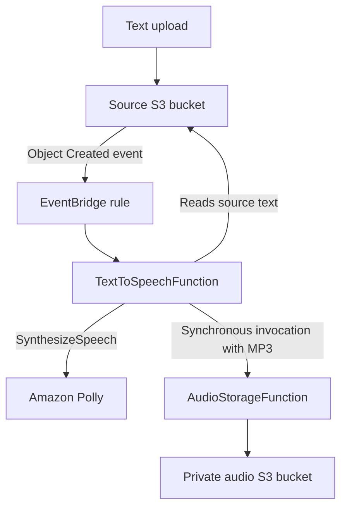

# Architecture

## Overview

The project is an AWS SAM application that converts short UTF-8 text files
uploaded to an S3 bucket into MP3 files in a separate, private S3 bucket.

## Components and flow

1. `SourceTextBucket` emits object-created events to EventBridge.
2. `TextObjectCreatedRule` matches `.txt` objects uploaded to that bucket and
   invokes `TextToSpeechFunction`.
3. `TextToSpeechFunction` reads and validates the UTF-8 text, then calls Polly
   `SynthesizeSpeech` with the configured voice and the standard engine.
4. The Lambda uses the deployment region for Polly when Polly is available
   there; otherwise, it uses `us-west-1`.
5. Synthesized MP3 bytes are base64-encoded and sent in a synchronous invocation
   to `AudioStorageFunction`.
6. `AudioStorageFunction` decodes the audio and writes it to `AudioBucket`,
   using the input object's key with its extension changed to `.mp3`.

The `PollyVoiceId` CloudFormation parameter configures the voice (and thus the
language); it defaults to `Joanna`.

## Security boundaries

- Both S3 buckets block public access.
- The audio bucket uses S3-managed AES-256 encryption and versioning.
- `TextToSpeechFunction` has read access only to the source bucket, permission
  to invoke Polly, and permission to invoke the storage Lambda.
- `AudioStorageFunction` has write access only to the audio bucket.
- The EventBridge rule is allowed to invoke only the text-to-speech Lambda.
- AWS credentials are supplied by the AWS execution/deployment environment;
  they are not stored in application source.

## Limits

- Text input is limited to 3,000 characters.
- The audio handoff uses a synchronous Lambda invocation and is limited to a
  6 MB serialized payload, including base64 and JSON overhead.
- For longer content, use Polly's asynchronous synthesis task with an S3 output
  destination rather than passing audio between Lambdas.

## Deployment

`template.yaml` defines the stack. Run `sam build` and `sam deploy --guided` to
build and deploy it. Local SAM build output and `samconfig.toml` are ignored by
Git; deployment settings should be configured for each developer or
environment.
