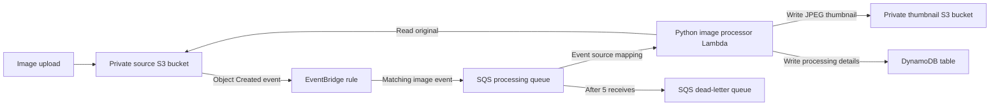

# Architecture

## Overview

The application decouples image-upload events from image processing using
EventBridge and SQS:

## Components and flow

1. `SourceImageBucket` emits object-created events to EventBridge.
2. `ImageUploadedRule` matches objects in the source bucket ending in the
   lowercase suffix `.jpg`, `.jpeg`, `.png`, or `.webp` and sends their event
   to `ImageProcessingQueue`.
3. The Lambda SQS event source mapping invokes `ImageProcessorFunction` with a
   single message per batch.
4. The function reads and validates the image, corrects EXIF orientation,
   resizes it to fit within 256 by 256 pixels, and encodes a JPEG thumbnail.
5. The function writes the thumbnail under `thumbnails/{source-key}.jpg` in
   `ThumbnailBucket` and records source, destination, dimensions, and processing
   time in `ImageProcessingTable`.
6. If processing fails, the function reports the SQS message as failed. SQS
   retries it and moves it to `ImageProcessingDeadLetterQueue` after five
   receives.

The queue decouples upload traffic from processing capacity, absorbs bursts,
and allows failed messages to be inspected or redriven independently.

## Security boundaries

- Source and thumbnail buckets block public access and use S3-managed
  encryption.
- The source bucket is read-only to the processor; the thumbnail bucket is
  write-only to it.
- The Lambda can write items only to the project DynamoDB table.
- Only the configured EventBridge rule can send messages to the processing
  queue.
- The queues use SQS-managed encryption. The dead-letter queue retains failed
  messages for up to 14 days.
- The processor receives only the permissions needed to read the source,
  create thumbnails, and record results.

## Delivery and limits

- S3, EventBridge, and SQS delivery is asynchronous and at-least-once. A
  processing event can be delivered more than once.
- Each SQS batch contains one message. Partial batch failure reporting lets
  failed records be retried without acknowledging them.
- The processing queue visibility timeout is 360 seconds, six times the
  function's 60-second timeout.
- The processor accepts image files up to 10 MiB and creates thumbnails no
  larger than 256 by 256 pixels.
- S3 events for unsupported key suffixes are filtered before reaching SQS.
- DynamoDB records use the EventBridge event ID as their partition key; a
  repeated delivery of the same event overwrites the same record.

## Deployment

`template.yaml` defines all resources and permissions. Run `sam validate
--lint`, `sam build --use-container`, and `sam deploy --guided` from the project
directory. A container build is recommended because Pillow includes
platform-specific native components.
