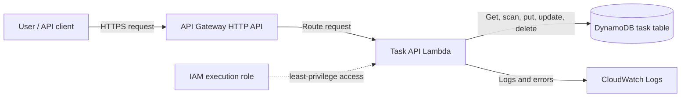

# Architecture

## Overview

The application exposes task operations through an API Gateway HTTP API. A
single Lambda function validates each request and reads or writes task records
in DynamoDB.



## Components and flow

1. `TaskHttpApi` accepts HTTPS requests for task routes.
2. API Gateway invokes `TaskFunction` with an HTTP API payload.
3. The Lambda validates the route and input, applies the requested operation,
   and returns a JSON response.
4. `TaskTable` stores each task using its generated `task_id` as the partition
   key. List requests scan the table.
5. Lambda operational messages and errors are sent to its CloudWatch log group,
   which retains logs for 14 days.

| Method | Route | Behavior |
| --- | --- | --- |
| `POST` | `/tasks` | Create a task |
| `GET` | `/tasks` | List tasks |
| `GET` | `/tasks/{taskId}` | Retrieve a task |
| `PUT` | `/tasks/{taskId}` | Update title and/or description |
| `PATCH` | `/tasks/{taskId}/complete` | Mark a task completed |
| `DELETE` | `/tasks/{taskId}` | Delete a task |

## Data model

Each item has the following shape:

```json
{
  "task_id": "generated-uuid",
  "title": "Read about serverless",
  "description": "Review the architecture",
  "completed": false,
  "created_at": "2026-01-01T12:00:00+00:00",
  "updated_at": "2026-01-01T12:00:00+00:00"
}
```

Task IDs are generated by the service. Create and update requests accept a
non-empty title of up to 200 characters and an optional description of up to
2,000 characters. The completion route sets `completed` to `true`.

## Security boundaries and current limitations

- DynamoDB encryption at rest and point-in-time recovery are enabled.
- The Lambda role can read, scan, create, update, and delete records only in
  `TaskTable`; API Gateway can invoke only this function.
- API Gateway currently has no authentication or authorization. The table uses
  `task_id` alone as its key, so all callers access the same task collection.
- The API does not include throttling, request authentication, or per-user
  access controls. Treat it as a learning project and do not put it on the
  public internet for sensitive use.
- Input validation, request error responses, and structured operational logs
  cover the basic API flow. More comprehensive policies and observability are
  listed in [the to-do list](todo.md).

## Deployment

`template.yaml` defines the HTTP API, Lambda, DynamoDB table, IAM permissions,
and Lambda log group. Run `sam validate --lint`, `sam build`, and
`sam deploy --guided` from the project directory.
